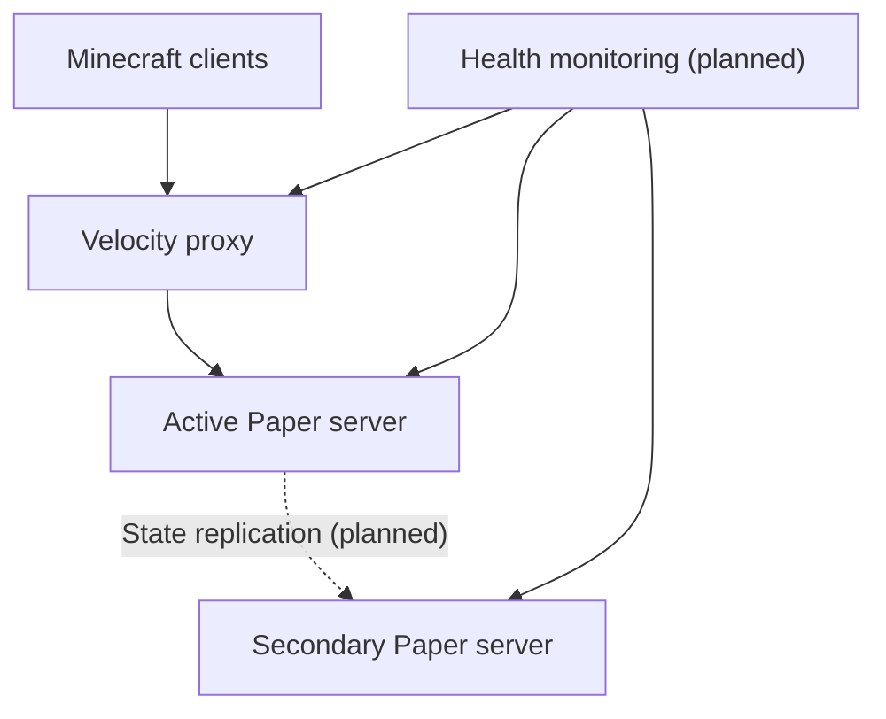

# Initial High-Availability Architecture

## Purpose

This document describes the initial architecture for a high-availability infrastructure lab. The lab uses a Minecraft server stack as its first stateful workload, but the main focus is failure detection, service continuity, data consistency, and recovery.

## Success Criteria

The initial targets are:

- Clients use a single service entry point.
- A failed application instance can be detected.
- Traffic can be redirected to a healthy instance.
- Client disruption is kept as short as practical.
- Potential world-data loss is limited to 10 seconds or less.
- Failover and recovery results are measured and documented.

These are design targets and should not be treated as completed capabilities until testing confirms them.

## Current Test Environment

| Component | Planned resources | Role |
|---|---:|---|
| Velocity proxy VM | 2 vCPU, 2 GB RAM, 12 GB storage | Provides the client entry point and routes connections |
| Primary Paper VM | 2 vCPU, 6 GB RAM, 25 GB storage | Runs the active application workload |
| Secondary Paper VM | 2 vCPU, 6 GB RAM, 25 GB storage | Provides a standby or alternate workload instance |

The first version is being developed with virtual machines. A later physical deployment may use separate Proxmox hosts.

## Logical Service Flow

The diagram represents the intended logical relationship. It does not imply that automatic replication or failover is already operational.

## Component Responsibilities

### Velocity Proxy

The proxy provides a stable entry point for clients and routes them to an available backend server. In the initial design, a single proxy remains a potential single point of failure.

### Primary Application Instance

The primary Paper server handles the active workload and owns the authoritative world state during normal operation.

### Secondary Application Instance

The secondary Paper server is intended to take over when the primary becomes unavailable. Its exact operating mode and data-synchronization method have not yet been selected.

### Health Monitoring

Monitoring should distinguish between several failure types:

- Process failure
- Virtual-machine failure
- Host failure
- Network isolation
- Application stall where the process remains running

## Planned Failure Tests

| Failure scenario | Expected behavior | Measurement |
|---|---|---|
| Paper process stops | Detect the failed service and select a healthy backend | Detection and recovery time |
| Primary VM stops | Redirect or recover the workload on another VM | Client interruption |
| Proxmox host fails | Restore service on another physical host | Total recovery time |
| Network path fails | Avoid routing traffic to an unreachable instance | Health-check accuracy |
| State replication falls behind | Prevent unsafe promotion or document possible loss | Recovery point and data loss |

## High Availability and Recovery

High availability and backups solve different problems:

- **High availability** reduces service interruption after a component fails.
- **Backups** provide recovery from corruption, deletion, or failures that affect every live copy.

The final lab should test both failover and restoration rather than treating replication as a replacement for backups.

## Known Limitations

- The current single Velocity proxy is a potential single point of failure.
- Automatic failure detection is not yet implemented.
- The data-replication method is undecided.
- Safe promotion and split-brain prevention are not yet designed.
- Physical multi-host failover has not yet been tested.
- Client reconnection behavior must be measured instead of assumed.

## Open Design Decisions

- Choose the world-data replication method.
- Choose the health-check and orchestration mechanism.
- Decide whether the secondary server is warm, hot, or cold standby.
- Define how promotion is authorized.
- Design split-brain protection.
- Decide how to make the proxy layer redundant.
- Define backup frequency, retention, and restoration testing.
- Determine which metrics and logs should be retained.

## Security and Documentation Rules

- Never commit passwords, tokens, private keys, or complete internal network details.
- Replace sensitive addresses and names with documented examples.
- Separate observed test results from assumptions.
- Record configuration changes through issues, branches, commits, and pull requests.
